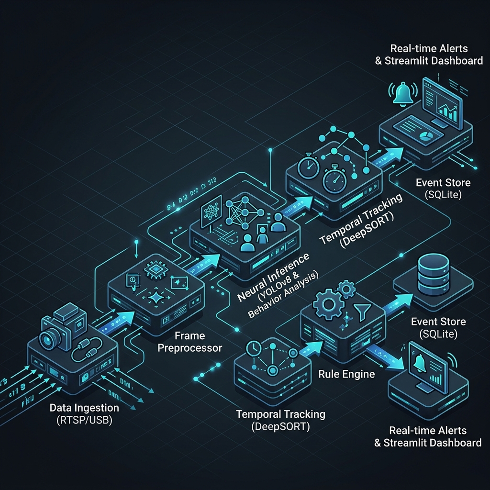

# AI Suspicious Activity Detection System

Real-time surveillance system using YOLOv8 (ONNX), DeepSORT, and MediaPipe/VL-JEPA2 for detecting suspicious activities.



## Team

| Member | Role | Primary Focus |
|--------|------|---------------|
| Shivam | Core Development | YOLOv8, DeepSORT, Main Pipeline |
| Sumedh | Dashboard & UI | Streamlit Monitoring, Team Dashboard |
| Snehasich | Testing & QA | Unit Tests, Integration Tests |
| Suhas | Documentation & DevOps | Setup Docs, Docker, CI/CD |

## Features

- **Object Detection**: People, vehicles, bags, weapons (YOLOv8 ONNX)
- **Multi-Object Tracking**: DeepSORT with consistent ID assignment
- **Behavior Analysis**: Fighting, running, loitering, crowd formation
- **Real-time Alerts**: Email, SMS, Webhook notifications
- **Web Dashboard**: Live monitoring with charts and event history
- **Team Dashboard**: Progress tracking for all team members

## System Requirements

| Component | Minimum | Recommended |
|-----------|---------|-------------|
| RAM | 16GB | 16GB+ |
| GPU | Intel UHD | 8GB VRAM (optional) |
| Python | 3.10 | 3.11 |
| Storage | 10GB | SSD |

### Optimized Configurations

**For 16GB RAM + Intel UHD Graphics:**
```yaml
detection:
  yolo_model: "yolov8n.onnx"  # Nano model
  use_openvino: true           # Intel acceleration
  confidence_threshold: 0.5

optimization:
  frame_skip: 3                # Process every 4th frame
  max_cameras: 1
  cpu_workers: 1
```

**For 8GB VRAM Systems (with VL-JEPA2):**
```yaml
behavior:
  backend: "vljepa2"           # Advanced behavior analysis
  use_gpu: true
```

## Quick Start

### 1. Setup Environment (5 minutes)

```bash
# Navigate to project
cd D:\Temp\AI_Surveillance

# Create and activate virtual environment
python -m venv .venv
.venv\Scripts\activate

# Upgrade pip
python -m pip install --upgrade pip
```

### 2. Install Dependencies (15 minutes)

```bash
# Core dependencies
pip install numpy opencv-python pyyaml pydantic scipy
pip install onnxruntime ultralytics mediapipe
pip install deep-sort-realtime scikit-learn
pip install streamlit flask twilio requests
pip install pytest pytest-cov

# Optional: Intel OpenVINO for Intel UHD Graphics
pip install openvino-dev
```

### 3. Download YOLOv8 Model (2 minutes)

```bash
# Export YOLOv8 to ONNX format
python -c "from ultralytics import YOLO; YOLO('yolov8n.pt').export(format='onnx')"

# Create models directory and move model
mkdir models
move *.onnx models\
```

### 4. Configure Camera

Edit `configs/default.yaml`:

```yaml
camera:
  # Option A: RTSP IP Camera
  rtsp_url: "rtsp://192.168.1.100:554/stream1"

  # Option B: USB Webcam
  rtsp_url: "0"

  # Option C: Video File (testing)
  rtsp_url: "videos/test.mp4"
```

### 5. Run Surveillance System

```bash
# Initialize database and start
python main.py --config configs/default.yaml

# Press 'q' to quit
```

### 6. Run Dashboards

**Monitoring Dashboard** (new terminal):
```bash
streamlit run dashboard\app.py
```

**Team Progress Dashboard** (new terminal):
```bash
streamlit run team_dashboard.py
```

## Project Structure

```
AI_Surveillance/
├── src/
│   ├── camera/          # Camera capture & preprocessing
│   │   ├── capture.py   # RTSP/USB camera with auto-reconnect
│   │   └── processor.py # Frame preprocessing for YOLO
│   ├── detection/       # Object & behavior detection
│   │   ├── yolo.py      # YOLOv8 ONNX detector
│   │   ├── behavior.py  # MediaPipe behavior analysis
│   │   ├── behavior_vjepa.py  # VL-JEPA2 option
│   │   └── rules.py     # Alert rule engine
│   ├── tracking/        # Multi-object tracking
│   │   ├── deepsort.py  # DeepSORT tracker
│   │   └── trajectory.py# Trajectory analysis
│   ├── alerting/        # Alert management
│   │   ├── engine.py    # Alert engine with rate limiting
│   │   └── channels.py  # Email, SMS, Webhook
│   ├── database/        # Data persistence
│   │   └── models.py    # SQLite schema & CRUD
│   └── dashboard/       # Web UI
│       └── app.py       # Streamlit monitoring
├── tests/               # Unit & integration tests
├── configs/             # YAML configurations
├── data/                # SQLite database storage
├── models/              # ONNX models
├── main.py              # Main entry point
├── team_dashboard.py    # Team progress UI
├── SETUP.md             # Detailed setup guide
└── IMPLEMENTATION_PLAN.md  # 4-week team plan
```

## Documentation

- **[SETUP.md](SETUP.md)** - Detailed step-by-step installation guide
- **[IMPLEMENTATION_PLAN.md](IMPLEMENTATION_PLAN.md)** - 4-week team task breakdown
- **[configs/default.yaml](configs/default.yaml)** - Configuration reference

## Testing

```bash
# Run all tests
pytest tests/ -v

# Run with coverage report
pytest tests/ -v --cov=src --cov-report=html

# Open coverage report
start htmlcov\index.html
```

## Performance Benchmarks

| System | FPS | Latency | Memory |
|--------|-----|---------|--------|
| 16GB RAM, Intel UHD | 8-12 | 150ms | 4-6GB |
| 16GB RAM, 8GB VRAM | 15-20 | 80ms | 6-8GB |
| 32GB RAM, 8GB VRAM + VL-JEPA2 | 10-15 | 120ms | 8-12GB |

## Troubleshooting

See **[SETUP.md](SETUP.md#troubleshooting)** for common issues and solutions.

## Contributing

1. Fork the repository
2. Create feature branch: `git checkout -b feature/your-feature`
3. Commit changes: `git commit -m "feat: description"`
4. Push to branch: `git push origin feature/your-feature`
5. Open Pull Request

## License

MIT License - See LICENSE file for details.

## Acknowledgments

- YOLOv8: Ultralytics
- DeepSORT: nwojke/cosine_metric_learning
- MediaPipe: Google
- Streamlit: Streamlit Inc.

## Project Structure

```
AI_Surveillance/
├── src/
│   ├── camera/          # Camera capture & preprocessing
│   ├── detection/       # YOLOv8, behavior analysis
│   ├── tracking/        # DeepSORT, trajectory
│   ├── alerting/        # Alert engine, channels
│   ├── database/        # SQLite models
│   └── dashboard/       # Streamlit monitoring UI
├── tests/               # Unit tests
├── configs/             # YAML configurations
├── dashboard.py         # Team progress dashboard
├── main.py              # Entry point
└── requirements.txt
```

## Contributing

1. Pick an issue from GitHub
2. Create branch: `feature/issue-<number>-<description>`
3. Open PR for review

## License

MIT
